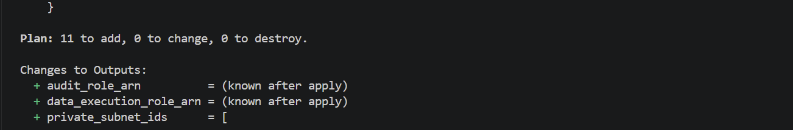

# Terraform Plan - Entorno DEV

## Descripción

Este documento contiene la evidencia de la ejecución
exitosa de terraform plan para la infraestructura base
del proyecto de Ingeniería de Datos en AWS.

## Configuración

- Entorno: dev
- Región: us-east-2 (Ohio)
- Infraestructura: Network + Identity
- Backend: Amazon S3 + DynamoDB

## Comando ejecutado

```bash
terraform plan
```

## Resultado

```text
Plan: 11 to add, 0 to change, 0 to destroy.
```

## Recursos planificados

| Recurso | Cantidad |
|---|---:|
| VPC | 1 |
| Subredes privadas | 2 |
| Tabla de rutas | 1 |
| Asociaciones de rutas | 2 |
| S3 Gateway Endpoint | 1 |
| Roles IAM | 2 |
| Políticas IAM | 2 |
| **Total** | **11** |

## Estado

Plan generado correctamente.

No se ejecutó terraform apply.
```
## Evidencia de ejecución

